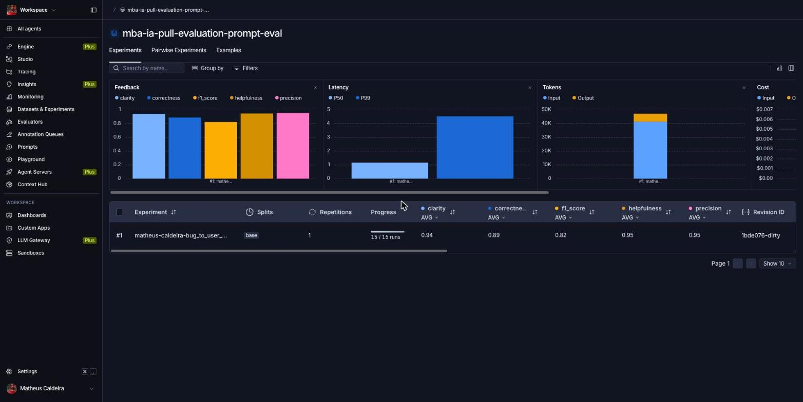
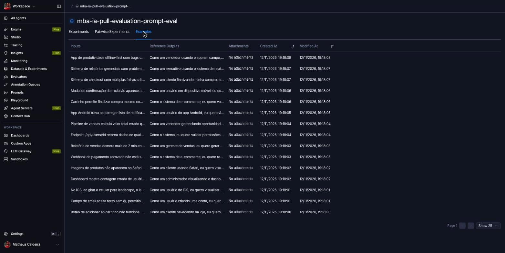
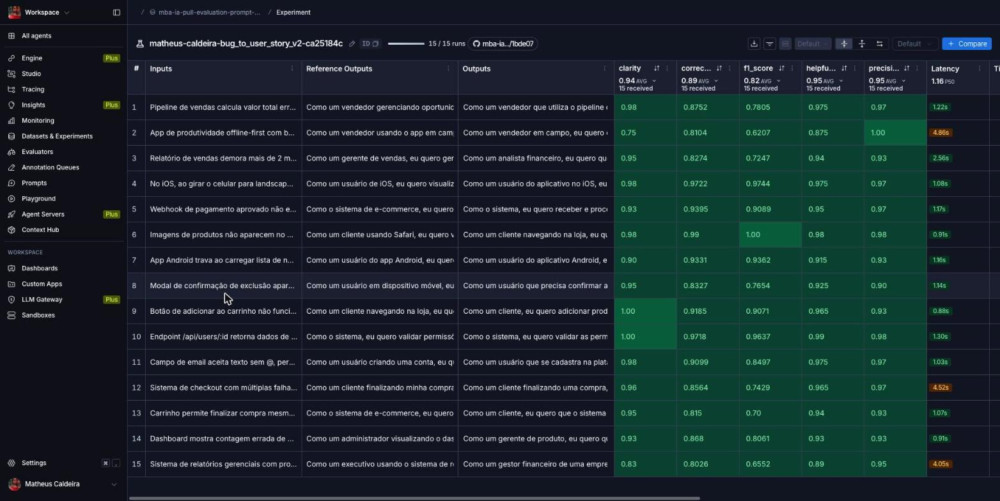
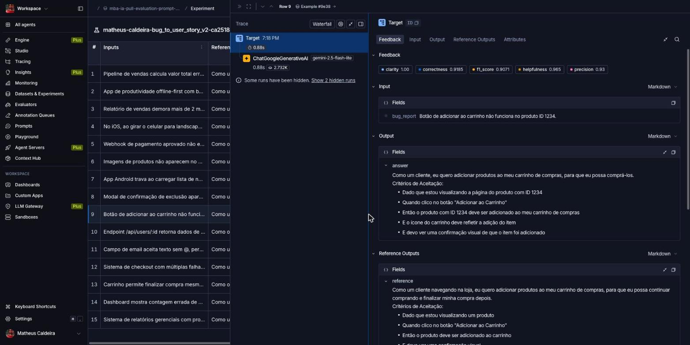
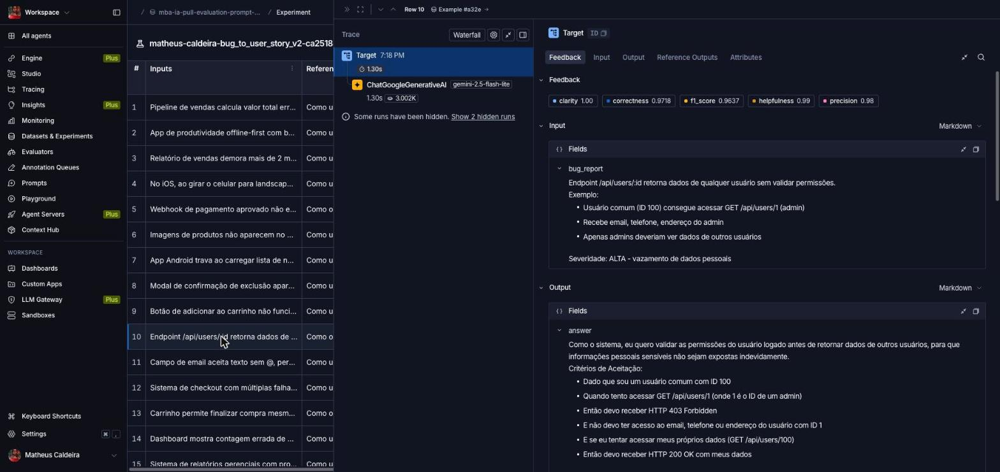
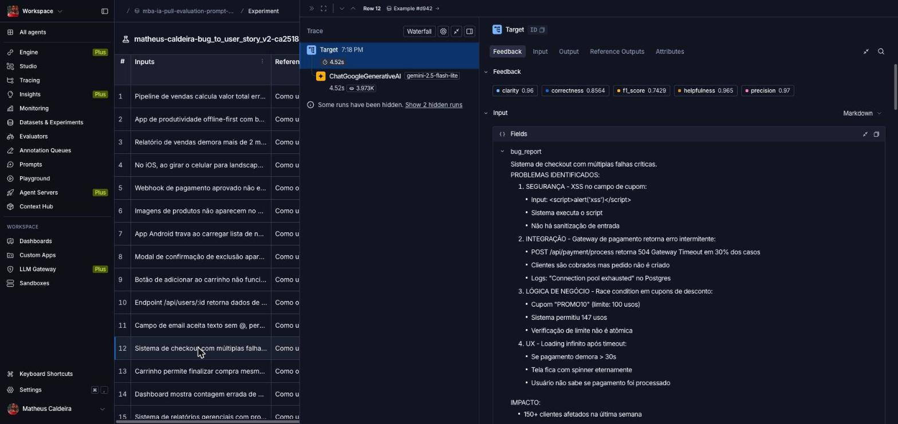

# Pull, Otimização e Avaliação de Prompts com LangChain e LangSmith

Entrega do desafio técnico de Prompt Engineering do MBA em Engenharia de Software
com IA (Full Cycle): fazer *pull* de um prompt de baixa qualidade do LangSmith
Prompt Hub, refatorá-lo com técnicas avançadas de Prompt Engineering, publicá-lo
de volta e avaliá-lo em 5 métricas (Helpfulness, Correctness, F1-Score, Clarity
e Precision), com meta de **≥ 0.8 em todas**.

- Prompt original: [`prompts/bug_to_user_story_v1.yml`](prompts/bug_to_user_story_v1.yml)
- Prompt otimizado: [`prompts/bug_to_user_story_v2.yml`](prompts/bug_to_user_story_v2.yml)

> **Resultado:** o v2 (`matheus-caldeira/bug_to_user_story_v2`) foi aprovado
> com **todas as 5 métricas ≥ 0.8** (média 0.91). Dataset e experimentos
> públicos: <https://smith.langchain.com/public/71aedd8a-5637-4b11-a84c-0e65427e2b47/d>.
> Detalhes em [Resultados Finais](#resultados-finais).

---

## Técnicas Aplicadas (Fase 2)

### O ponto de partida: o que havia de errado na v1

A v1 tem quatro defeitos estruturais, todos visíveis no arquivo:

1. **`{bug_report}` duplicado** no `system_prompt` **e** no `user_prompt` — o
   relato entra duas vezes na mesma chamada.
2. **Sem persona** — abre com "Você é um assistente que ajuda a transformar
   relatos de bugs", o que produz texto genérico, sem vocabulário de produto.
3. **Sem exemplos** — nenhuma saída de referência, então o formato da resposta
   fica à sorte do modelo.
4. **Sem formato nem regras** — "crie uma user story a partir dele" é a
   instrução inteira. Não define o padrão *Como/eu quero/para que*, não pede
   critérios de aceitação, não proíbe inventar dados.

As técnicas abaixo atacam cada um desses pontos. Elas estão declaradas no campo
`techniques_applied` do v2 (lido pelo teste `test_minimum_techniques` e
publicado no readme do prompt no Hub por `src/push_prompts.py`).

### 1. Role Prompting

**Por quê.** Persona genérica gera texto genérico: o modelo não sabe se escreve
para um desenvolvedor, um cliente ou um gestor, e o tom oscila a cada chamada.
Uma persona específica ancora vocabulário, nível de detalhe e critério de
qualidade.

**Como apliquei.** O `system_prompt` abre com:

> Você é um Product Manager sênior com mais de 10 anos de experiência em
> produtos digitais, especialista em traduzir relatos técnicos de bugs em User
> Stories acionáveis. Você trabalha lado a lado com times de engenharia ágeis e
> é reconhecido por escrever histórias que os desenvolvedores conseguem
> implementar sem precisar de uma única reunião de esclarecimento.

A última oração é a parte funcional: define um critério de qualidade para a
própria saída ("implementável sem reunião de esclarecimento"), não só um cargo.

### 2. Few-shot Learning *(obrigatória pelo enunciado)*

**Por quê.** É a técnica de maior impacto para fixar **formato**, e formato é
justamente o que a v1 não especificava. Descrever um layout em prosa é muito
menos eficaz do que mostrar uma saída pronta.

**Como apliquei.** Seção `## Exemplos` com **3 pares entrada→saída completos**,
um por nível de complexidade — a mesma divisão do dataset (5 simples, 7 médios,
3 complexos):

| Exemplo | Nível | Demonstra |
| --- | --- | --- |
| 1 — evento recorrente some da agenda | simples | parágrafo canônico + 5 bullets Gherkin, e **nada além disso** |
| 2 — anexo de chat acessível após sair do canal | médio (segurança) | seções extras `Critérios Adicionais para Auditoria:` e `Contexto de Segurança:` |
| 3 — upload de arquivos falha silenciosamente | complexo | cabeçalhos `=== ... ===`, blocos `A./B./C.` e tasks com prefixos `[SEGURANÇA]`, `[INFRA]` |

Os três exemplos foram **escritos do zero**, em domínios que não aparecem no
dataset de avaliação, para que as métricas meçam generalização e não
memorização (ver [Sem vazamento do dataset](#sem-vazamento-do-dataset-nos-exemplos-few-shot)).

### 3. Chain of Thought (silencioso)

**Por quê.** Converter bug → User Story não é reformatar texto: exige inferir
**quem** é afetado (o relato quase nunca diz), **qual** é o comportamento
correto (o relato descreve o defeito, não o desejado) e **por que** isso
importa. Respondendo direto, o modelo escorrega para "eu quero que o botão pare
de falhar" — que descreve o bug, não a história.

**Como apliquei.** Roteiro de 5 passos, executado antes de escrever:

> 1. Identifique QUEM é afetado pelo bug (...). Esse é o ator da história.
> 2. Identifique QUAL é o comportamento correto esperado — não o defeito. A
>    User Story descreve o estado desejado, nunca o erro.
> 3. Identifique POR QUE isso importa para o negócio ou para o usuário.
> 4. Avalie a COMPLEXIDADE do relato (...)
> 5. Derive os critérios de aceitação diretamente dos fatos do relato.

Logo abaixo, a trava que torna o CoT compatível com métricas que comparam a
saída com uma referência limpa:

> Esse raciocínio é SILENCIOSO. Nunca escreva os passos, nunca escreva
> "Passo 1", nunca explique seu processo.

Sem ela, o raciocínio vazaria para a resposta e prejudicaria Precision e Clarity.

### 4. Instruções explícitas de formato e comportamento

**Por quê.** A v1 não tinha nenhuma regra verificável. As métricas penalizam
alucinação (Precision), omissão (F1) e ruído (Clarity), então cada um desses
riscos virou uma regra numerada.

**Como apliquei.** Seis regras no `system_prompt`, entre elas:

> 1. Baseie-se APENAS nos fatos presentes no relato. Nunca invente números,
>    prazos, nomes de serviço, versões ou métricas que não foram informados.
> 2. Descreva o comportamento desejado, nunca o defeito.
> 4. Preserve os identificadores técnicos citados no relato — rotas, códigos
>    HTTP, nomes de campo, IDs — exatamente como aparecem.

Mais o formato canônico obrigatório (`"Como um <persona>, eu quero <objetivo>,
para que <benefício>."`), o Gherkin em português (`- Dado que`, `- Quando`,
`- Então`, `- E`) e a proibição de cercas de código e negrito — verificados por
`test_prompt_mentions_format`.

**Calibragem por complexidade** (técnica próxima do *Skeleton of Thought*: um
esqueleto de resposta diferente por nível): *"o tamanho da resposta deve
acompanhar o tamanho do problema. Detalhe a mais é tão penalizado quanto
detalhe a menos."* Um bug de uma frase que recebe `=== TASKS TÉCNICAS
SUGERIDAS ===` perde Precision por informação inventada; um bug com 4 problemas
numerados que recebe 5 bullets perde F1.

### 5. Tratamento de edge cases

**Por quê.** O dataset tem relatos vagos, relatos sem passos de reprodução e
relatos com múltiplos problemas numerados. Sem regra explícita, o modelo
preenche a lacuna inventando — o que a Precision pune.

**Como apliquei.** Cinco casos com instrução própria; o mais interessante:

> - RELATO VAGO (ex.: "o site está lento", sem página nem número): produza
>   mesmo assim a User Story (...). Não invente métricas de performance.
>   Acrescente um único bullet começando com "- Premissa assumida:" declarando
>   a interpretação adotada.

Ou seja: a suposição é **declarada** em vez de disfarçada de fato. Os outros
quatro cobrem relato sem passos de reprodução, pedido de funcionalidade
disfarçado de bug, múltiplos problemas (uma única história, critérios agrupados
em blocos) e impacto de segurança.

### Separação System vs User Prompt

A v1 duplicava `{bug_report}` nos dois prompts. Na v2 a variável vive **apenas**
no `user_prompt`:

```yaml
user_prompt: |-
  Relato de Bug:
  ---
  {bug_report}
  ---

  User Story:
```

O `system_prompt` contém só instruções estáveis. `src/push_prompts.py` tem duas
guardas que abortam o push se isso regredir: `validate_prompt()` exige
`{bug_report}` no `user_prompt` e o **proíbe** no `system_prompt`, e uma segunda
checagem compara `chat_prompt.input_variables` com `{"bug_report"}`, falhando se
alguma chave `{` literal não escapada criar uma variável fantasma (erro que
quebraria os 15 exemplos da avaliação de uma vez).

---

## Resultados Finais

### Comparação v1 vs v2: o que mudou e por quê

| # | Problema na v1 | Evidência na v1 | Solução na v2 |
| --- | --- | --- | --- |
| 1 | Variável duplicada | `{bug_report}` no `system_prompt` **e** no `user_prompt` | Variável só no `user_prompt`; guarda em `push_prompts.py` impede regressão |
| 2 | Persona genérica | "Você é um assistente que ajuda a transformar relatos de bugs" | Product Manager sênior, 10+ anos, com critério de qualidade explícito |
| 3 | Zero exemplos | nenhuma saída de referência | 3 pares entrada→saída, um por nível de complexidade |
| 4 | Sem formato de saída | "crie uma user story a partir dele" | Formato canônico *Como/eu quero/para que* + Gherkin em PT-BR, texto plano |
| 5 | Sem regras de comportamento | nenhuma | 6 regras numeradas (não inventar, comportamento ≠ defeito, critérios testáveis, preservar IDs técnicos, concisão, sem preâmbulo) |
| 6 | Sem raciocínio guiado | resposta direta | CoT silencioso de 5 passos (ator → comportamento → benefício → complexidade → critérios) |
| 7 | Sem edge cases | nenhum | 5 casos tratados, incluindo o bullet `- Premissa assumida:` para relatos vagos |
| 8 | Sem calibragem de tamanho | nenhuma | 3 níveis de detalhe (simples / médio / complexo), cada um com estrutura própria |
| 9 | Sem metadados de técnica | só `version`, `created_at`, `tags` | `techniques_applied` com 5 entradas, publicadas no readme do prompt no Hub |

**Comparação de métricas v1 vs v2:** o `src/evaluate.py` (que o enunciado manda
não alterar) avalia apenas o prompt otimizado, então o v1 não foi medido nesta
entrega. Os números do v1 no enunciado (~0.45–0.52, reprovado) são ilustrativos;
os do v2 abaixo são a medição real.

Como as métricas se relacionam (`src/evaluate.py`): **F1-Score**, **Clarity** e
**Precision** são medidas por LLM-as-Judge; as outras duas são derivadas:
`Helpfulness = (Clarity + Precision) / 2` e `Correctness = (F1 + Precision) / 2`.
A aprovação exige as **cinco** ≥ 0.8, e não só a média.

### Avaliação do v2 no LangSmith

- **Link público do dataset de avaliação** (com os experimentos):
  **https://smith.langchain.com/public/71aedd8a-5637-4b11-a84c-0e65427e2b47/d**
- Prompt publicado (público): `matheus-caldeira/bug_to_user_story_v2`
- Dataset: `mba-ia-pull-evaluation-prompt-eval` (15 exemplos)
- Modelos: `gemini-2.5-flash-lite` gera a resposta; `gemini-2.5-flash` avalia
  (LLM-as-Judge), ambos com `temperature=0`.

Saída real de `./venv/bin/python src/evaluate.py`:

```
==================================================
Prompt: matheus-caldeira/bug_to_user_story_v2
==================================================

Métricas Derivadas:
  - Helpfulness: 0.95 ✓
  - Correctness: 0.89 ✓

Métricas Base:
  - F1-Score: 0.82 ✓
  - Clarity: 0.94 ✓
  - Precision: 0.95 ✓

--------------------------------------------------
📊 MÉDIA GERAL: 0.9097
--------------------------------------------------

✅ STATUS: APROVADO - Todas as métricas >= 0.8
```

| Métrica | v2 | Mínimo |
| --- | --- | --- |
| Helpfulness | 0.95 | 0.8 |
| Correctness | 0.89 | 0.8 |
| F1-Score | 0.82 | 0.8 |
| Clarity | 0.94 | 0.8 |
| Precision | 0.95 | 0.8 |
| **Média** | **0.91** | 0.8 |

### Iterações

O v2 foi construído offline antes do acesso ao LangSmith, usando os 15 exemplos
do dataset como referência de **estilo** (não de conteúdo — ver "Sem vazamento"
abaixo): calibragem de tamanho por complexidade, formato canônico e Gherkin em
PT-BR foram ajustados lendo as saídas de referência. Na primeira avaliação real
ele já atingiu ≥ 0.8 nas cinco métricas, então não houve nova rodada.

O ponto mais apertado é o **F1-Score (0.82)**: os exemplos com F1 mais baixo
(#2 offline-first 0.62, #15 relatórios gerenciais 0.66, #13 carrinho 0.70) são
os de relato longo, em que o modelo escolhe uma persona ou um recorte de
critérios diferente do gabarito (ex.: "analista financeiro" em vez de "gerente
de vendas"). Clarity e Precision ficam ≥ 0.75 em todos os 15 exemplos.

### Screenshots

**Experimento do v2 com as 5 métricas ≥ 0.8**



**Dataset de avaliação com os 15 exemplos**



**Notas por exemplo (15/15 runs)**



**Tracing detalhado de 3 exemplos** (entrada, saída gerada, referência e notas)

1. Bug simples — "Botão de adicionar ao carrinho não funciona no produto ID 1234"

   

2. Bug médio (segurança) — `/api/users/:id` sem validação de permissão

   

3. Bug complexo — checkout com 4 falhas críticas (XSS, gateway, race condition, UX)

   

### Sem vazamento do dataset nos exemplos few-shot

Um risco comum em few-shot é copiar itens do próprio dataset de avaliação para
dentro do prompt: o modelo recebe o gabarito e a nota passa a medir cópia, não
capacidade. Cada um dos 3 exemplos do v2 foi cruzado contra a entrada e a saída
de referência dos 15 itens de `datasets/bug_to_user_story.jsonl` (texto
normalizado: sem acentos, caixa baixa, espaços colapsados), por
`difflib.SequenceMatcher` e pela fração de linhas idênticas:

```
Exemplo 1 entrada: max SequenceMatcher 0.335 (ex[2])  | linhas idênticas 0.000
Exemplo 1 saida:   max SequenceMatcher 0.135 (ex[4])  | linhas idênticas 0.143
Exemplo 2 entrada: max SequenceMatcher 0.211 (ex[2])  | linhas idênticas 0.000
Exemplo 2 saida:   max SequenceMatcher 0.268 (ex[7])  | linhas idênticas 0.294
Exemplo 3 entrada: max SequenceMatcher 0.235 (ex[3])  | linhas idênticas 0.000
Exemplo 3 saida:   max SequenceMatcher 0.145 (ex[12]) | linhas idênticas 0.194
maior similaridade: 0.335
```

As linhas idênticas residuais são rótulos estruturais (`Critérios de
Aceitação:`, `Contexto de Segurança:`, `Severidade: ALTA`, `=== CONTEXTO DO BUG
===`) — exatamente o vocabulário de formato que o few-shot existe para ensinar.

### Testes de validação

Saída real de `./venv/bin/python -m pytest tests -v`:

```
tests/test_prompts.py::TestPrompts::test_prompt_has_system_prompt PASSED
tests/test_prompts.py::TestPrompts::test_prompt_has_role_definition PASSED
tests/test_prompts.py::TestPrompts::test_prompt_mentions_format PASSED
tests/test_prompts.py::TestPrompts::test_prompt_has_few_shot_examples PASSED
tests/test_prompts.py::TestPrompts::test_prompt_no_todos PASSED
tests/test_prompts.py::TestPrompts::test_minimum_techniques PASSED

6 passed
```

| Teste | Garante |
| --- | --- |
| `test_prompt_has_system_prompt` | campo existe, é string não vazia, e `validate_prompt_structure()` passa |
| `test_prompt_has_role_definition` | contém "Você é" e uma persona de produto (Product Manager/Owner/PO) |
| `test_prompt_mentions_format` | exige "Como um", "eu quero", "para que", "Critérios de Aceitação" e o Gherkin PT-BR |
| `test_prompt_has_few_shot_examples` | ≥ 2 pares `Relato de Bug:` / `User Story:` **e** few-shot declarado em `techniques_applied` |
| `test_prompt_no_todos` | nenhum `TODO` em `description`, `system_prompt`, `user_prompt` ou nas técnicas |
| `test_minimum_techniques` | `techniques_applied` é lista com ≥ 2 entradas, nenhuma vazia |

---

## Como Executar

### Pré-requisitos

- **Python 3.10+**
- Conta no **LangSmith** com:
  - `LANGSMITH_API_KEY` — em *Settings → API Keys*
  - **handle público do Hub** (`USERNAME_LANGSMITH_HUB`) — criado ao tornar um
    prompt público pela primeira vez (ver passo 1 em
    [Passo a passo para concluir](#passo-a-passo-para-concluir))
- **Uma** chave de LLM:
  - `GOOGLE_API_KEY` — https://aistudio.google.com/app/apikey (tem tier gratuito,
    com limites que mudam com frequência), **ou**
  - `OPENAI_API_KEY` — https://platform.openai.com/api-keys

### 1. Ambiente virtual

```bash
python3 -m venv venv
./venv/bin/pip install -r requirements.txt
```

O `venv/` fica dentro do projeto e está no `.gitignore`. Os comandos abaixo usam
`./venv/bin/python` explicitamente, então não é preciso ativar o ambiente
(se preferir: `source venv/bin/activate`).

Dependências principais (`requirements.txt`): `langchain-core` 1.x, `langsmith`
0.13 (Prompt Hub, datasets e avaliação), `langchain-google-genai`,
`langchain-openai`, `python-dotenv`, `pyyaml` e `pytest`.

### 2. Variáveis de ambiente

```bash
cp .env.example .env
```

Preencha:

```ini
LANGSMITH_TRACING=true
LANGSMITH_ENDPOINT=https://api.smith.langchain.com
LANGSMITH_API_KEY=                  # sua chave
LANGSMITH_PROJECT=mba-ia-pull-evaluation-prompt   # também nomeia o dataset ({projeto}-eval)
USERNAME_LANGSMITH_HUB=             # seu handle público do Hub

LLM_PROVIDER=google                 # ou openai
LLM_MODEL=gemini-2.5-flash-lite     # modelo que gera a User Story
EVAL_MODEL=gemini-2.5-flash         # modelo juiz (pode ser o mesmo ou um mais capaz)
GOOGLE_API_KEY=                     # ou OPENAI_API_KEY, conforme o provider
```

Os modelos acima são os configurados neste projeto; o desafio não fixa versões,
então confira a documentação do provider antes de escolher. Use modelos que
aceitem `temperature=0`. O `.env` está no `.gitignore` — nunca versione chaves.

### 3. Testes de validação *(offline, sem chave)*

```bash
./venv/bin/python -m pytest tests/test_prompts.py -v
```

Rode a cada edição do `bug_to_user_story_v2.yml`.

### 4. Pull do prompt original *(LangSmith)*

```bash
./venv/bin/python src/pull_prompts.py
```

Baixa `leonanluppi/bug_to_user_story_v1` com
`Client().pull_prompt(..., dangerously_pull_public_prompt=True)` e grava em
`prompts/bug_to_user_story_v1.yml`.

### 5. Edição do prompt otimizado

Edite `prompts/bug_to_user_story_v2.yml`. Ao mexer no `system_prompt`:

- chaves literais `{` e `}` **devem** ser escapadas como `{{` e `}}`;
- a variável `{bug_report}` fica **só** no `user_prompt`.

### 6. Push do prompt otimizado *(LangSmith)*

```bash
./venv/bin/python src/push_prompts.py
```

Valida a estrutura, monta o `ChatPromptTemplate` (system + user) e publica
`{USERNAME_LANGSMITH_HUB}/bug_to_user_story_v2` com `is_public=True`, descrição,
tags e as técnicas aplicadas no readme do prompt.

### 7. Avaliação *(LangSmith + LLM)*

```bash
./venv/bin/python src/evaluate.py
```

Cria (ou reaproveita) o dataset `{LANGSMITH_PROJECT}-eval` com os 15 exemplos de
`datasets/bug_to_user_story.jsonl`, puxa o v2 do Hub, executa cada exemplo,
grava as 5 notas como feedback no experimento e imprime o link dele. São cerca
de 60 chamadas de LLM por execução (15 gerações + avaliações), o que pode
esbarrar no *rate limit* do tier gratuito do Gemini.

### Resumo das fases

| Fase | Comando | Rede? | Consome LLM? |
| --- | --- | --- | --- |
| Testes | `./venv/bin/python -m pytest tests -v` | não | não |
| Pull | `./venv/bin/python src/pull_prompts.py` | sim | não |
| Editar v2 | manual | não | não |
| Push | `./venv/bin/python src/push_prompts.py` | sim | não |
| Avaliar | `./venv/bin/python src/evaluate.py` | sim | sim (~60 chamadas) |

---

## Estrutura do projeto

```
mba-ia-pull-evaluation-prompt/
├── .env.example                      # template das variáveis de ambiente
├── requirements.txt                  # dependências Python
├── README.md                         # este arquivo
├── prompts/
│   ├── bug_to_user_story_v1.yml      # prompt original (baixa qualidade)
│   └── bug_to_user_story_v2.yml      # prompt otimizado
├── datasets/
│   └── bug_to_user_story.jsonl       # 15 exemplos (5 simples, 7 médios, 3 complexos)
├── src/
│   ├── pull_prompts.py               # pull do Hub (implementado)
│   ├── push_prompts.py               # push público do v2 (implementado)
│   ├── evaluate.py                   # avaliação nas 5 métricas (fornecido)
│   ├── metrics.py                    # LLM-as-Judge: F1, Clarity, Precision (fornecido)
│   └── utils.py                      # YAML, env, fábrica de LLM multi-provider (fornecido)
└── tests/
    └── test_prompts.py               # 6 testes de validação (implementado)
```
